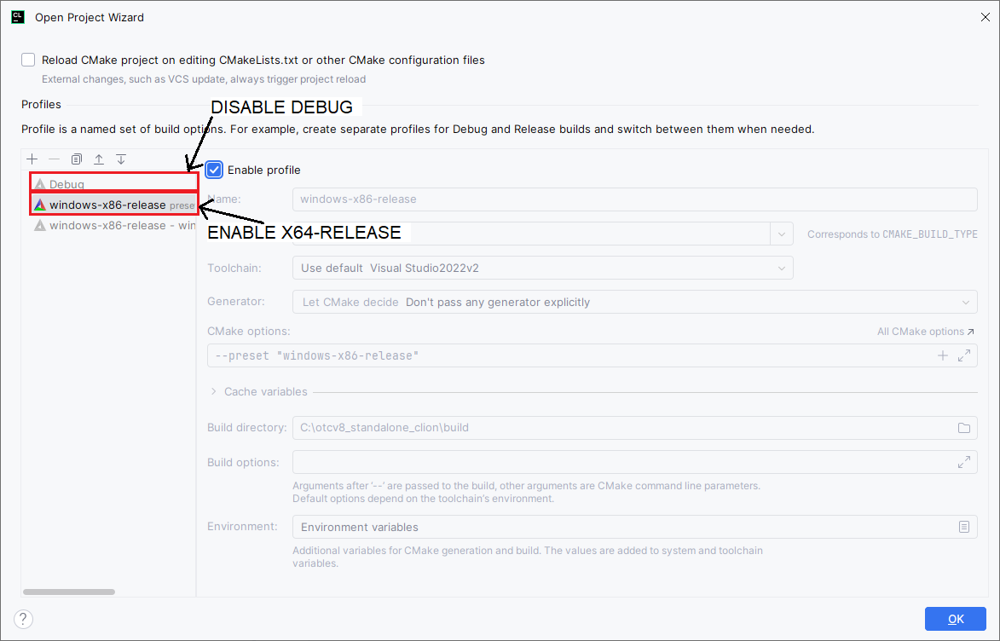
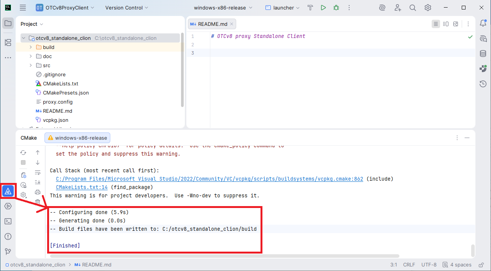
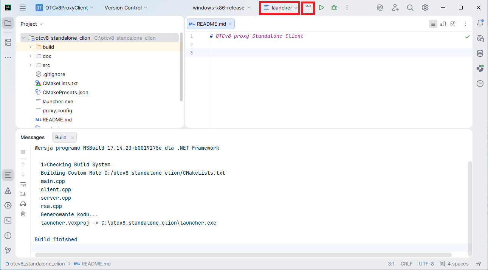
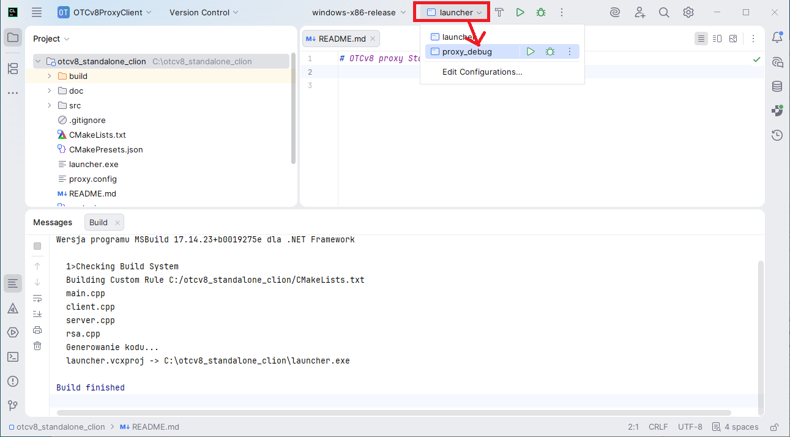
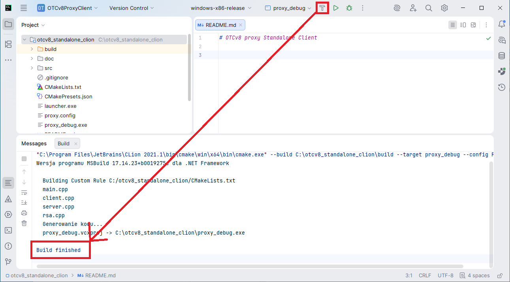

# Compilation with CLion

This guide explains how to compile the project using JetBrains CLion on Windows.

## 1. Prerequisites

Before starting, ensure you have:
*   Installed and integrated **vcpkg** - refer to [vcpkg-installation.md](vcpkg-installation.md) for detailed setup instructions.

## 2. Opening the Project

1. Launch **CLion**.
2. Select **Open** and navigate to the project's root directory.
3. CLion will automatically detect the `CMakeLists.txt` and `CMakePresets.json` files.

## 3. Configuring CMake Profiles

By default, CLion will try to use a standard Debug profile which is not compatible with the project's static vcpkg dependencies.

It should automatically open "Project Wizard". If it did not, manually open the **Project Wizard**:
1. Go to **File > Settings** (or `Ctrl+Alt+S`).
2. Navigate to **Build, Execution, Deployment > CMake**.

Disable `Debug` and enable `windows-x86-release`:
1. Under **Profiles**:
    *   **Disable** the default **Debug** profile.
    *   **Enable** the **windows-x86-release** profile (this comes from `CMakePresets.json`).
2. Click **OK**.

## 4. CMake Synchronization

After applying the settings, CLion will reload the CMake project. You can monitor the progress in the **CMake** tool window at the bottom. Wait until you see "Configuring done" and "Generating done".

It will install the required C++ libraries using vcpkg. It may take a while.

## 5. Building the Executables

The project defines multiple targets. You can choose which one to build using the dropdown menu in the top right corner.

### Building `launcher.exe`
1. Select the **launcher** target.
2. Click the **Build** icon (the hammer) or press `Ctrl+F9`.

### Building `proxy_debug.exe`
1. If you need the debug version of the proxy, switch the target to **proxy_debug**.
2. Click the **Build** icon.

Check the **Messages** or **Build** tab to confirm that the compilation finished successfully.

## 6. Output Location

After a successful build, the executables will be located in the root directory (as configured in `CMakeLists.txt`):
*   `launcher.exe`
*   `proxy_debug.exe` (if built)
