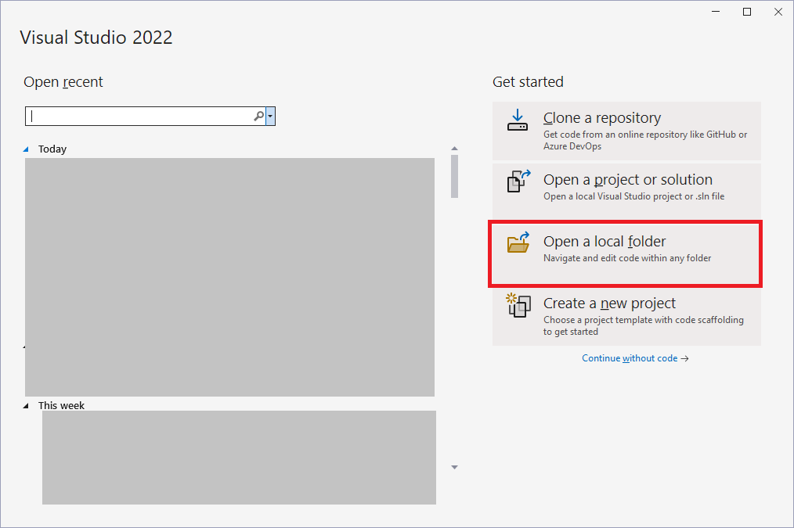
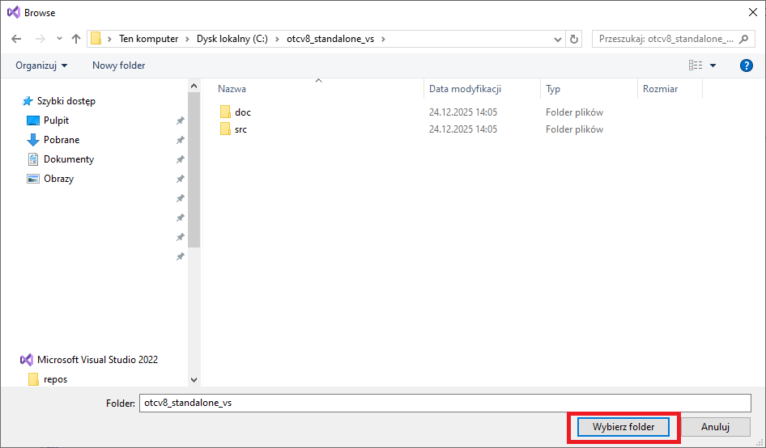
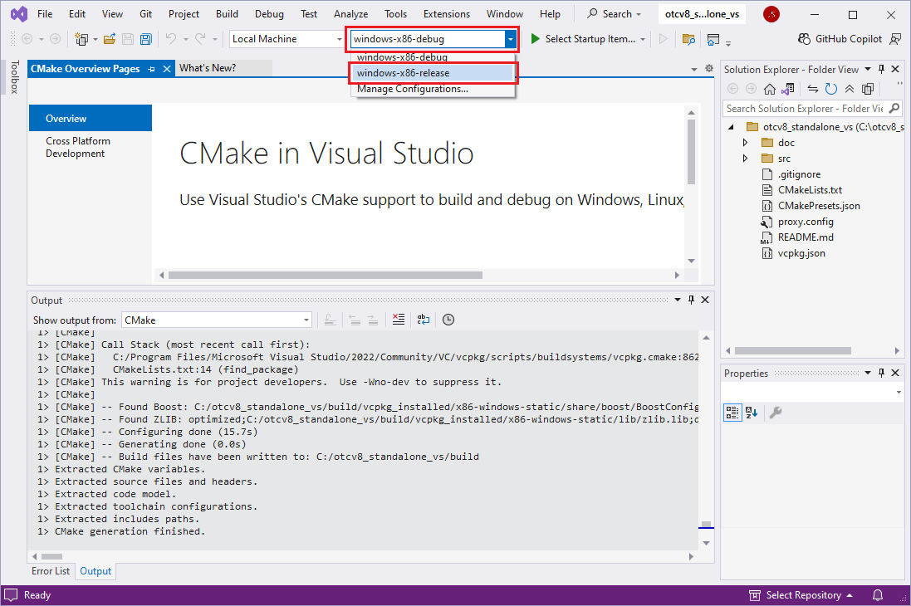
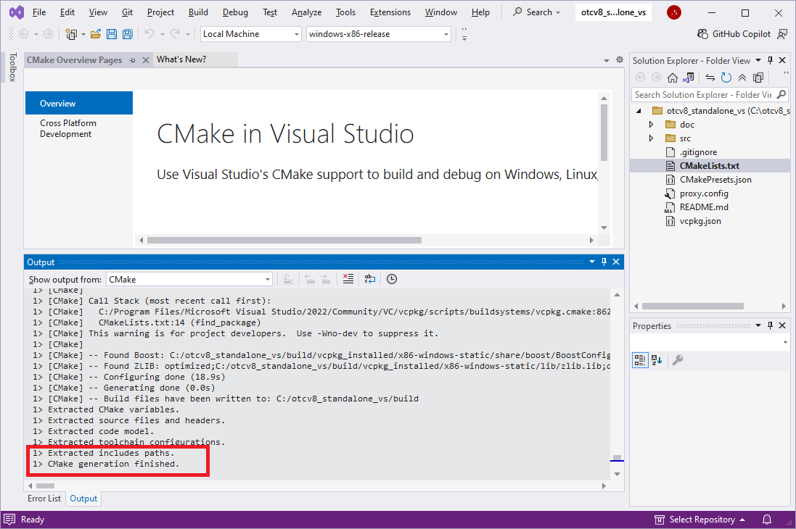
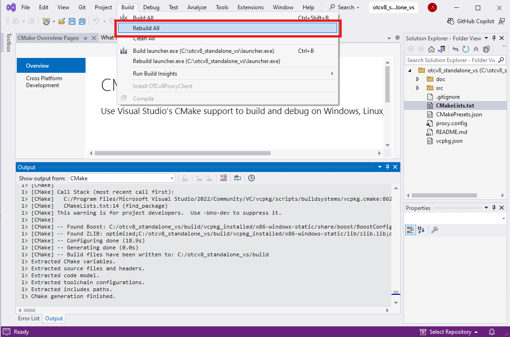

# Compilation with Visual Studio

This guide explains how to compile the project using Microsoft Visual Studio 2022 on Windows.

## 1. Prerequisites

Before starting, ensure you have:
*   Installed and integrated **vcpkg** - refer to [vcpkg-installation.md](vcpkg-installation.md) for detailed setup instructions.

## 2. Opening the Project

1. Launch **Visual Studio 2022 or 2026**.
2. Select **Open a local folder**.
3. Navigate to the project's root directory (where `CMakeLists.txt` is located) and click **Select Folder**.
4. Visual Studio will start loading the CMake project. You can see the progress in the **Output** window (dropdown: CMake).

## 3. Selecting the Configuration

Once the project is loaded, you need to select the correct configuration preset.

1. In the top toolbar, look for the configuration dropdown (it usually defaults to `windows-x86-debug`).
2. Select **windows-x86-release**.
3. Wait for Visual Studio to finish "CMake generation".

## 4. Building the Project

1. To build everything, go to **Build > Build All**.
2. The compilation results will appear in the **Output** window.

## 5. Output Location

After a successful build, the executables will be located in the root directory (as configured in `CMakeLists.txt`):
*   `launcher.exe`
*   `proxy_debug.exe`
