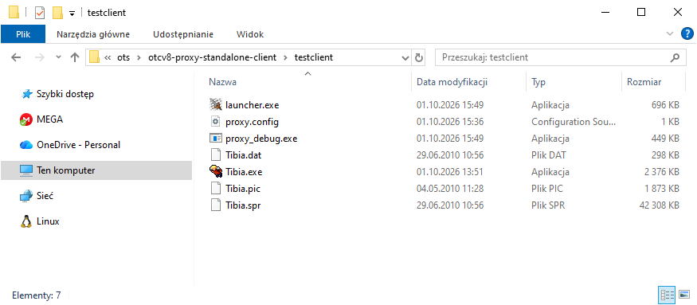

# Configuration

To set up a proxy, you need:
1. Tibia Client that connects to `127.0.0.1`
2. Compiled Launcher.exe from this project
3. Configured haproxy on VPSes
4. OTCv8 proxy on server with OTS

In this example configuration I will put all haproxies, OTCv8 proxy (Alpha proxy) and OTS on a single VPS with Ubuntu 24.04.

### 1. Tibia Client that connects to 127.0.0.1

You can download the Tibia client here:
- https://downloads.ots.me/?dir=data/tibia-clients/windows/zip
- https://downloads-oracle.ots.me/?dir=data/tibia-clients/windows/zip

In this example I use 8.60.

Now you have to:
- replace an RSA key in `Tibia.exe` with an OTS RSA key
- replace RL Tibia domains with your server domains

You can do it manually with this tutorial:
https://otland.net/threads/custom-client-8-6-10-xx.212219/

or use tool that does it for you online:
- https://ots.me/ots-ip-changer/
- https://oracle.ots.me/ots-ip-changer/

### 2. Compiled Launcher.exe

Compile Launcher.exe from this project - check compilation documentation - or download a Release version from GitHub.

### 3. Configured haproxy on VPSes

In this example, I will put all proxies on the same VPS as OTS (on different ports), but it's just to test proxy using a single VPS:
```
My Server Name
.\Tibia.exe
7171 7172
188.245.102.85 188.245.102.85 6501
188.245.102.85 188.245.102.85 6502
188.245.102.85 188.245.102.85 6503
```

In the real world the whole goal is to put proxy on multiple VPSes that will filter DDoS attacks and reduce the chance of losing connection.

This is how looks folder with OTCv8 proxy launcher, Tibia.exe and all other client files. On screenshot, I put proxy_debug.exe - it's a file for an OTS owner to test, if the proxy works: 

